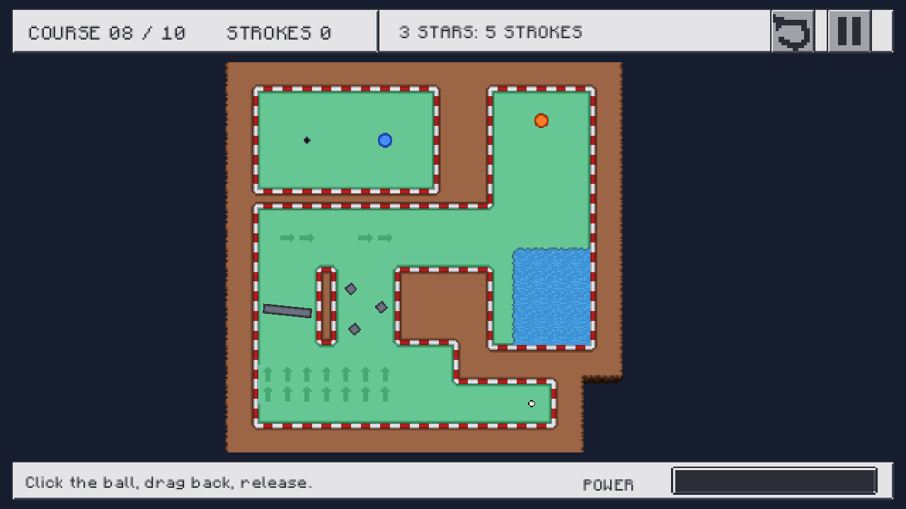

# Minigolf Basic Project

A 2D pixel-art minigolf game built with **Godot and GDScript** for Basic Project 2026–2027. Aim, drag back, and release to guide the ball through ten handcrafted courses with as few strokes as possible.

**Version 1.0.0 is available for Windows x64**, including the latest map 10 update.

[Download version 1.0](https://github.com/GabTommy2006/Basic-Project---2026-27---Minigolf/releases/tag/v1.0.0)



## Download and play

1. Open the [1.0 release page](https://github.com/GabTommy2006/Basic-Project---2026-27---Minigolf/releases/tag/v1.0.0).
2. Download **SummerMinigolf-1.0.0-Windows-x64.zip** from the release assets.
3. Extract the ZIP and open **SummerMinigolf.exe** inside the Windows folder.

The executable includes the game resources. You do not need to install Godot. The ZIP also includes instructions, release notes, and license notices. The EXE is available separately on the same release page.

To enable fullscreen, open **Settings** and switch **Fullscreen** on.

## Controls

- **Left mouse button:** click and hold near the stationary ball, drag opposite the direction you want to shoot, then release.
- **Power meter:** drag farther for a stronger shot, up to the maximum power.
- **Esc:** pause or resume during play; return or close dialogs where applicable.
- **R:** open the restart confirmation during an active attempt.

Wait for the ball to stop before taking another shot. A ball moving too quickly can roll across the hole without being captured.

## Features

- Ten handcrafted courses with progressive unlocking and individual star targets.
- Grass and sand with different rolling resistance.
- Water hazards that return the ball to its previous shot position and add a penalty stroke.
- Arrow tiles that redirect and accelerate the ball once the entire ball enters the tile.
- Round and triangular bumpers, rotating obstacles, moving obstacles, and blinking gates.
- Linked orange and blue portals with travel effects.
- An English interface with a main menu, course selection, HUD, pause menu, results, and settings.
- Camera framing that keeps the playable course visible and follows the ball within the available screen space.
- Looping background music, gameplay sound effects, and separate music and sound volume controls.
- Automatic progress saving, best scores, highest star ratings, recovery copies, Continue, and New Game.

## Stars and progression

Completing a course unlocks the next one. Earn three stars by finishing within that course's target, two stars with up to two additional strokes, or one star for any other completed attempt. Water penalties count toward the score.

The three-star targets for courses 1–10 are **2, 3, 3, 4, 5, 4, 5, 5, 6, and 7 strokes**. These values are configured in [Game/courses.json](Game/courses.json).

Replaying a course with a worse result does not replace your best score or reduce your earned stars.

## Save data

The game automatically saves unlocked courses, records, stars, the last selected course, audio settings, and fullscreen preferences.

On Windows, the profile is stored at:

```text
%APPDATA%\Godot\app_userdata\Minigolf Basic Project\summer_golf.cfg
```

- **Continue** starts the last selected course from its beginning. It does not restore a ball's position halfway through a shot.
- **New Game** asks for confirmation before resetting progress, stars, and records. Audio and display settings are retained.
- A recovery copy and validated temporary writes help recover progress if a save is interrupted or damaged.
- The exported game and the editor version use the same profile location on the same Windows account.

See [player data documentation](Docs/PlayerData.md) for recovery behavior and format details. That guide is currently in Vietnamese.

## Run the source project

Use **Godot 4.7.2**, matching the release build. The project uses **GDScript** and **Forward+**, with Direct3D 12 configured on Windows. The .NET edition is not required.

```sh
git clone https://github.com/GabTommy2006/Basic-Project---2026-27---Minigolf.git minigolf
cd minigolf
```

1. Import `project.godot` in Godot and allow the assets to finish importing.
2. Press **F5** to run the full game from `UI/Main.tscn`.
3. To inspect an individual course, open `Maps/Courses/Map1.tscn` through `Map10.tscn` and press **F6**. Standalone scenes do not include the full menu, HUD, or progression flow.
4. Press **F8** in the editor to stop the running game.

`Maps/TestMap.tscn` and `Maps/MechanicsPlayground.tscn` are development scenes for testing individual mechanics.

## Export for Windows

The [Windows export preset](export_presets.cfg) produces a Windows x64 Release build with an embedded resource pack.

Install the **Godot 4.7.2 export templates** through the editor. In the Windows Desktop preset, clear the two **Custom Template** paths if the local template cache under `tmp/export-templates/` is unavailable. Create `output/Windows/` before exporting.

Use **Project → Export → Windows Desktop → Export Project**, with **Export With Debug** disabled, or run:

```powershell
& 'C:\Program Files\Godot_v4.7.2-stable_win64.exe' --headless --path . --export-release 'Windows Desktop' 'output/Windows/SummerMinigolf.exe'
```

Adjust the Godot executable path for your installation. Keep the instructions and license notices with the game when distributing a ZIP. Additional export notes are in [Docs/ExportWindows.md](Docs/ExportWindows.md).

## Tests

From the project directory, run the regression suite in PowerShell:

```powershell
./Tools/run_tests.ps1 -CheckRestart
```

For a different Godot installation:

```powershell
./Tools/run_tests.ps1 -GodotPath 'C:\path\to\Godot.exe' -CheckRestart
```

The runner covers **13 test groups and 8 cross-process save/restart phases**: gameplay physics, obstacles, portals, UI interactions, camera framing, audio, save recovery, and New Game. Logs are written to `tmp/test-results/`. Tests use separate QA profiles rather than the player's actual save.

The 1.0 review also checked the native Release executable, fullscreen framing, rendered Power meter states, and 301 shots across 80 simulated sessions. These checks describe the tested scenarios; playtesting remains useful when changing course layouts or balancing star targets.

See [Tests/README.md](Tests/README.md) for individual test scripts.

## Project layout

```text
Assets/           Textures, fonts, TileSets, UI atlas, and audio
ArtDrafts/        Aseprite sources, design references, and audio review materials
Game/             Course catalog, star targets, save system, and audio director
Maps/Courses/     The ten authored course scenes
Objects/          Ball, hole, bumpers, obstacles, portals, and effects
UI/               Main menu, HUD, settings, and result screens
Tests/            Automated gameplay and regression checks
Tools/            Development utilities and test runner
Docs/             Guides, release notes, and screenshots
project.godot     Godot project settings
export_presets.cfg Windows export configuration
```

`.godot/`, `tmp/`, and `output/` are excluded from Git. Download compiled builds from **GitHub Releases**. The older course-generation utilities under `Tools/Courses/` contain early layouts; edit the authored course scenes directly to preserve the current maps.

## Credits and documentation

The game uses the project's SummerTile artwork and SummerUI v2 steel-frame interface assets. Selected audio includes effects by **Kenney** and **rubberduck**, and the background track **Sherwood** by **Chris Murphy / zesona**. Audio sources and CC0 notices are recorded in [Assets/Audio/CREDITS.md](Assets/Audio/CREDITS.md) and [Assets/Audio/Licenses/](Assets/Audio/Licenses/). Godot and third-party engine notices are included in the downloadable ZIP.

Further project guides are currently written in Vietnamese:

- [Release notes](Docs/ReleaseNotes.md)
- [Course editing](Docs/ChoiVaSua10Map.md)
- [Placing and configuring objects](Docs/DatVatTheLenMap.md)
- [HUD and interface](Docs/UIHUD.md)
- [Player data and recovery](Docs/PlayerData.md)
- [Audio selection and preview tools](Docs/AudioSelection.md)
